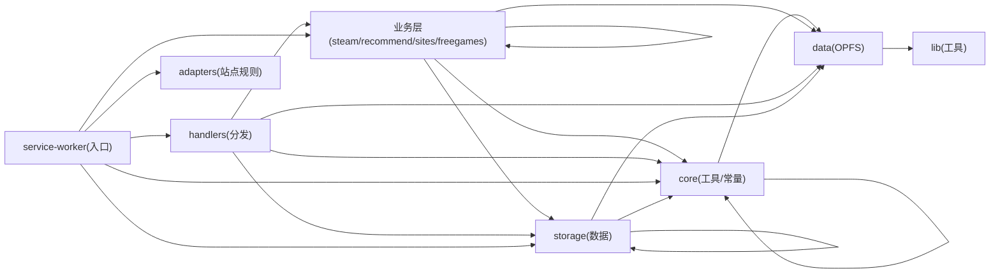

# 游戏雷达 Game Radar - 游戏智能推荐

基于浏览行为学习的 Chrome 浏览器扩展，自动预判游戏下载概率、集成 Steam 评分系统，并支持多下载站资源智能检索。

[](https://github.com/tgfxpfgt/game-recommender)

## 核心功能

### 1. 浏览行为追踪与智能推荐

- 自动追踪用户在下载站（XDGame、咸鱼单机、Gamer520、3DM、游侠、游民星空等）的浏览行为
- 基于浏览历史学习用户偏好，智能推荐相关游戏
- 在列表页实时显示推荐分数徽章
- 推荐信号融合 Steam 好评率、游玩时长、热度（当前在线）、销量、评论数与个人行为数据（v10.5.3 起销量/评论数入算）

### 2. Steam 信息集成

- 在下载站详情页自动注入 Steam 信息浮窗
- 咸鱼单机 / Gamer520 详情页标题下方内嵌 Steam 玩家评价卡（与 XDGame 原生信息区 1:1 复刻：综合评分 / 好评率 / 评测数 / 好评差评 / 修正口碑，v10.5.3）
- 显示 Steam 总体评价、简体中文评价、SteamDB 评分三重评价体系
- 展示中文支持情况（简/繁体中文、音频、字幕）
- 显示热门用户标签、发行日期、开发商等信息
- 展示简体中文评测摘要

### 3. Steam 好评率过滤

- 在列表页自动显示每个游戏的 Steam 好评率徽章；最前面另有 ⭐ 综合评分徽章（XDGame「Steam 玩家评价」同口径：综合评分 = 修正口碑 ÷ 10，悬停显示评级/好评差评/修正口碑明细，按 AppID 多站共用缓存，v10.5.3）
- 支持按好评率阈值过滤，隐藏低评分游戏
- 过滤后自动重排列表，不留空白
- 阈值可在扩展菜单和设置页面中调整（0%-95%，步进 5%）

### 3.5 虚拟机版过滤

- 在下载站列表页隐藏标题包含"虚拟机板/虚拟机"关键词的游戏（可自定义关键词）
- 命中后从 DOM 移除整个栅格列容器，避免留空
- 过滤在请求 Steam 数据之前执行，同时节省 API 调用

### 4. 下载站资源检索

- 在 Steam 游戏详情页自动搜索三大下载站（XDGame/咸鱼单机/Gamer520）的对应资源（检索范围可在设置中自定义勾选）
- 显示资源更新日期、版本、文件大小等元信息
- 支持跨语言标题匹配（中英文独立匹配算法 + 自适应检索）
- 提供下载站详情页跳转链接，用户可在详情页手动获取资源

### 5. 下载历史记录

- 在下载站详情页自动记录每次下载行为
- 显示上次下载时间、下载站点、下载次数
- 提供快捷链接跳转至上次下载页面

### 6. 限免游戏监控

- 自动监控 Epic Games、GOG、GamerPower 等平台的限免游戏
- 每日自动刷新，支持一键领取跳转
- 浏览器扩展图标角标显示未领取数量

### 7. 数据管理

- 支持数据备份与恢复（JSON 格式）
- 设置页面支持自动保存（800ms 防抖，无需手动点击保存）
- 游戏缓存管理页：按 AppID/中英文名/好评率/Steam 标签/下载站多条件组合检索、分页查看、单个删除或清空全部缓存；AppID 可点击跳转 Steam、支持单条手动更新（Steam 中英文名/标签 + 下载站地址）；一键清理过期缓存、一键修复异常中英文名
- 可配置的日志记录系统（内存缓冲防抖写入）
- 调试面板（开发模式）

### 8. 适配规则管理（v3.0）

- 设置页"规则管理"面板：查看/编辑下载站适配规则（JSON 编辑器 + 校验 + 字段说明表）
- 保存的规则覆盖内置规则，可独立导出/导入分享，一键恢复内置
- 后台安全校验：纯数据白名单、拒绝函数注入、规模上限

### 9. 统一浮窗体系（v3.1）

- 所有浮窗（工作状态/诊断调试、Steam 信息、下载站资源、下载历史）统一管理
- 分区定位、防重叠堆叠、统一折叠/关闭
- 工作状态浮窗：任务进度 → 完成统计（计时）→ 3 秒后自动消失或切换诊断视图

### 10. 自适应检索（v3.1.2）

- 游戏名检索失败时自动尝试删词组合搜索（尾部/头部逐词删除 + 已学噪声词清洗）
- 成功后自动学习被跳过的噪声词（计数确认 ≥3 次生效，防误学副标题）

### 11. 收藏与数据洞察（v10.6.0+）

- 详情浮窗 **☆ 收藏**（上限 500）；数据分析页收藏专区；收藏游戏进限免时通知带前缀提示
- **Steam250 排名**与 **ITAD 历史最低价**行（后者需配置 ITAD API Key）
- **运行指标卡**：评分批次 P95 耗时 / 会话磁盘写次数 / 会话消息总数（GET_RUNTIME_METRICS）
- **AppID 行为统计**（a-b 徽章）：跨站点下载/详情打开计数，参与推荐评分（v10.1.0）

### 12. 主题与体验（v10.6.0+）

- **20 套皮肤** + 日/夜主题定时切换（夜间窗口起止小时可调，支持跨零点）
- 列表浮窗合并面板：好评率过滤（滑块实时生效）+ 列表布局定制（对称扩展）；浮窗折叠状态记忆
- **离线备份加密**（AES-GCM + PBKDF2，口令不落盘）；二维码跨域解码转链接
- 检索规则随使用自动改进，新站点标题修饰词无需手动维护

## 安装方式

### 开发者模式加载

1. 下载本项目代码到本地
2. 打开 Chrome 浏览器，访问 `chrome://extensions/`
3. 开启右上角"开发者模式"
4. 点击"加载已解压的扩展程序"
5. 选择项目根目录文件夹

### 权限说明

| 权限         | 用途                                                                |
| ------------ | ------------------------------------------------------------------- |
| `storage`    | 存储用户偏好、浏览记录、缓存数据                                    |
| `alarms`     | 定时刷新限免游戏与自动备份                                          |
| `<all_urls>` | 内容脚本注入与跨域请求（下载站/Steam/限免 API/用户自定义 LLM 端点） |

### 油猴脚本版（userscript/game-radar.user.js）

不装扩展时的轻量形态——扩展核心功能移植为单文件 Tampermonkey 脚本（v14.14.0 口径）：

1. 浏览器安装 [Tampermonkey](https://www.tampermonkey.net/)
2. Tampermonkey 面板 → 添加新脚本 → 粘贴 `userscript/game-radar.user.js` 全文 → 保存
   （或拖入安装；脚本头部 `@match` 限定 XDGame / 咸鱼单机 / Gamer520 新旧域名，其他站零注入）

**包含**：列表页好评率徽章（总体 + 近 30 天 + 红标题阈值 + 等待队列显示 + 未找到点击重查）、
低/零评测 `#AppID·新游/未发售/无评测/评测少` 可见提示、详情页 Steam 信息浮窗（无评价原因行 +
发售日期 + 手动选择候选键盘导航 + 网络故障 30s 自动重查）、智能匹配管线（storesearch 全词扫描

- 跨词共识 + 社区英文兜底 + 英文段重搜 + DLC→本体解析 + 封面 appId 直取）、负缓存分级退避
  （15min→1h→2h）、分域熔断 + 150ms 限速、好评率过滤与红标题阈值（油猴菜单可调）、人工纠正
  映射（候选选择即记忆，优先于一切索引）。

**与扩展的差异**：无扩展页（弹窗/设置页/仪表盘/限免监控/SidePanel）、无推荐值/行为统计/二维码/
限免/Steam250/ITAD 行、目录离线索引与 Bing/LLM 兜底与 Metacritic 平台徽章未移植、缓存存于
Tampermonkey 存储（有界 800 条评分）。数据端点与解析语义（含商店页回退三形态、404=空结果）
与扩展 v14.14.0 一致；评分缓存不共享（扩展 chrome.storage 与油猴 GM 存储相互独立）。

## 项目结构

```
game-recommender/
├── manifest.json              # 扩展配置文件（Manifest V3）
├── adapters/                  # 适配规则（default 基础 + sites 各站）
│   ├── default.js / index.js
│   └── sites/                 # 6 个下载站独立配置
├── shared/
│   └── escape.js              # 共享 HTML 转义工具（popup/options/dashboard/freegames）
├── background/                # 后台（模块化）
│   ├── service-worker.js      # 入口（导入/监听/定时/初始化）
│   ├── handlers.js            # 消息处理与分发映射（聚合 MESSAGE_HANDLERS）
│   ├── handlers/              # 分组 handler（steam/cache-manager/data-modules/stats/download-sites）
│   ├── core/                  # 常量/工具/设置/规则/重置/机制工厂
│   ├── storage/               # 数据模块（缓存/注册表/索引/日志/备份/噪声词...）
│   ├── steam/                 # 标题解析/API/编排器
│   ├── recommend/engine.js    # 推荐算法
│   ├── sites/search.js        # 下载站搜索
│   └── freegames/manager.js   # 限免管理
├── content/                   # 内容脚本（模块化）
│   ├── tracker.js             # 入口（预热/init/启动/监听）
│   ├── module-manifest.js     # 内容模块清单（单源：核心并行 + 可选按设置条件加载）
│   ├── core/                  # common 工具 / floats 统一浮窗 / status-bar 状态栏 / debug 调试
│   ├── adapters/builder.js    # 适配器构建
│   ├── list/list-page.js      # 列表页功能
│   ├── detail/detail-page.js  # 详情页功能
│   └── tracking/download-tracking.js # 下载追踪
├── data/
│   ├── data-store.js          # OPFS 数据存储层
│   └── storage-registry.js    # 存储模块注册表（单源：文件/格式/备份/清除范围派生）
├── lib/
│   └── ndjson.js              # ND-JSON 编解码库
├── tests/                     # 自动化测试套件（vitest 26 套件单 runner）
├── styles/content.css
├── popup/                     # 工具栏弹窗
├── options/                   # 设置页（入口 + panels/ 四面板）
├── dashboard/                 # 数据分析
├── freegames/                 # 限免页面
└── icons/
```

## 技术架构

### 依赖分层（v4.1.0 静态断言 + 自动生成图）

后台单向分层 `core → storage → 业务层 → handlers → 入口`，由 `tests/integration/test-integrity.mjs` 静态扫描全部 import 断言（CI 拦截回归，v6.3.0 起 test-layers 并入）；`node tests/integration/test-integrity.mjs --print` 可重新生成下图：



### 后台服务工作者 (service-worker.js)

- **Steam API 编排器**：搜索游戏 → 获取详情 → 解析语言支持 → 获取评测 → SteamDB/SteamSpy 数据；自适应检索（删词组合 + 噪声词自动学习）
- **下载站搜索引擎**：多搜索词策略 + 跨语言匹配算法 + 链接匹配度评分，站点配置来自规则文件
- **三层缓存系统（v5，以 appId 为唯一标识）**：
  - `gameRegistry` 游戏注册表：中英文名以 Steam 官方为准 + 下载站标题名称变体 + 封面图，永久保留、30 天重确认
  - `nameIndex` 名称索引：游戏名 → appId O(1) 反查（含规范化名键，跨站变体命中同一 appId），2h 负缓存
  - `downloadUrls` 下载站网址缓存：30 天有效，按站点分桶存储（v2），列表页批量写入 + 详情页访问更新
  - 三层均带内存缓存与防抖批量写入，减少 storage I/O；Steam 好评率等缓存跨站共享，检索优先命中缓存
  - 中英文名异常自动自愈（并行获取官方名）；一键清理过期缓存（三类按 TTL）
- **消息分发**：统一的 handler 映射表，支持行为追踪、推荐计算、设置管理等
- **SSRF 防护**：所有外部请求经 host 校验（仅 http/https，拒绝私有/环回地址），本地 LLM 端点除外

### 内容脚本 (tracker.js)

- **规则驱动的页面适配**：适配规则来自 `adapters/sites/` 目录（域名、列表页识别、列表项提取选择器），添加新下载站只需在规则文件中新增一项
- **document_start 注入 + 预热**：脚本加载即并行唤醒后台/加载规则，DOM 就绪立即开始工作（零延迟）
- **两波好评率流程**：第一波仅查缓存（命中徽章即时显示），未命中的后台从 Steam 拉取、每批完成后增量推送
- **统一浮窗体系（GR.float）**：状态/诊断/Steam 信息/下载站资源/下载历史全部统一管理，分区定位、防重叠、可折叠关闭
- **好评率徽章**：在列表页游戏标题前显示 Steam 好评率；0 评测游戏显示灰色 AppID，未匹配显示"未找到"
- **好评率过滤**：根据阈值自动移除低评分游戏并重排列表
- **预载下一页**：延迟 2s 自动预热下一页 Steam 缓存，翻页后好评率过滤秒开
- **appId 直取**：从页面 Steam 图片 URL 提取 appId 直接获取详情，绕过标题搜索
- **异步消息通信**：与后台服务工作者通过 Chrome Messaging API 通信
- **性能优化**：调试面板防抖刷新（250ms），下载追踪使用事件委托，全页扫描设上限（500 链接）

### 设置页面 (options.js)

- **自动保存**：所有设置修改后 800ms 自动保存，无需手动点击
- **实时状态反馈**：保存中/已保存状态指示器
- **防抖处理**：避免频繁保存请求

### 安全设计

- 所有用户输入经 HTML 转义防 XSS
- 百度网盘链接拼接提取码时进行域名验证
- 所有外部请求经 host 校验（仅 http/https，拒绝 localhost/环回/私有/保留地址），防 SSRF

## 支持的下载站

| 站点     | 域名           | 支持功能                         |
| -------- | -------------- | -------------------------------- |
| XDGame   | xdgame.com     | 列表/详情 + Steam 资源检索       |
| 咸鱼单机 | xianyudanji.gg | 列表/详情 + Steam 资源检索       |
| Gamer520 | gamer520.com   | 列表/详情 + Steam 资源检索       |
| 3DM游戏  | 3dmgame.com    | 列表/详情/行为追踪（无站内检索） |
| 游侠网   | ali213.net     | 列表/详情/行为追踪（无站内检索） |
| 游民星空 | gamersky.com   | 列表/详情/行为追踪（无站内检索） |

## 数据源

- **Steam Store API**：游戏搜索、应用详情、评测数据
- **SteamDB**：评分、在线人数、历史最低价
- **SteamSpy**：SteamDB 被拦截时的补充数据
- **Epic Games API**：限免游戏信息
- **GOG API**：限免游戏信息
- **GamerPower API**：限免游戏聚合

## 配置与设置

在扩展设置页面（右键扩展图标 → 选项）可配置：

- 启用/禁用插件、工作状态浮窗开关
- 推荐高亮阈值（30%-90%）
- Steam 好评率过滤（开关 + 0%-95% 阈值）
- 虚拟机版过滤（关键词自定义）
- 推荐算法权重（点击率、下载率、关键词匹配、Steam 评分）
- AI 大模型推荐（支持 Ollama 本地模型 / OpenAI 兼容接口）
- 缓存有效期（小时/天/月/年，0=长期有效）
- 追踪网站管理与 Steam 检索范围
- 适配规则管理（编辑/导入导出/恢复内置）
- 日志配置（级别/保留天数/存储形式）
- 数据备份与恢复、自动备份开关与间隔

**所有设置自动保存**，修改后 800ms 自动同步，也可点击底部"立即保存"按钮强制保存。

## 开发说明

### 本地开发

```bash
# 贡献指南（架构心智模型/测试体系/发布流程）/ contributing guide
# 见 CONTRIBUTING.md

# 一键验证（lint + 单测）/ full check (lint + unit tests)
npm run check

# 单测（v6.2.0 起单 runner 全量统一）：vitest 覆盖全部 26 套件（765 test）
npm test          # vitest run（26 套件，含 content-sim 与 handlers 集成）
npm run coverage  # vitest 覆盖率（v8 provider）

# 安装 git 钩子（提交信息格式校验 + 暂存 JS 语法检查，v4.1.2）
npm run install-hooks

# 语法检查
node --check background/service-worker.js
node --check content/tracker.js
node --check popup/popup.js
node --check options/options.js

# 加载到 Chrome 进行调试
# 访问 chrome://extensions/ → 开发者模式 → 加载已解压的扩展程序
```

### 发布前深度扫描（Mimosa）

完整发布（大版本/中版本/触发线达标）前执行 Mimosa 深度安全扫描（`security_scan` 工具，focusFiles 覆盖本次改动文件），将返回的 **seal**（`sha256:...`）记录到 release notes 与项目记忆，作为可复核的封印标识；历史扫描存放于仓库外 `~/.mimosa/security-scans/`（仓库内 `.mimosa/` 产物已 gitignore）。

### 缓存版本控制

修改 `STEAM_CACHE_VERSION` 常量可强制使旧缓存失效，用于发布数据结构变更后的强制刷新。

## 维护模式（2026-10-30 起）

十轮迭代路线图（第一轮～第十轮，2026-09-28～2026-10-30）全部收官。项目转入
**维护模式**：用户反馈 P1/P2 走热修；新下载站适配/新数据源按需小轮；发版按
触发线（大版本 / 5 次小版本 / 单次 >1000 行 / 累计 >3000 行）。功能需求请提
Issue（含"未找到"错题样本可经 dashboard 一键导出附上）。

## 更新日志

完整版本流水见 [CHANGELOG.md](./CHANGELOG.md)（v14.28.0 起从 README 拆出）。
